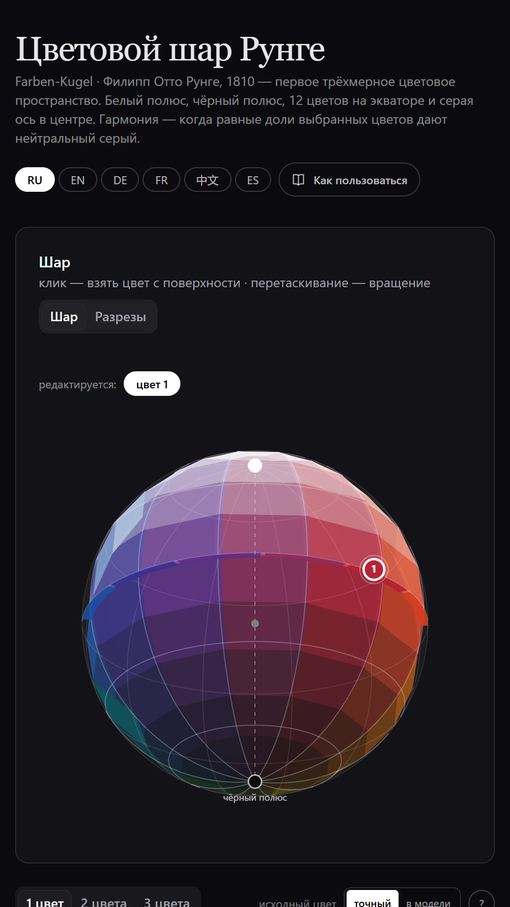
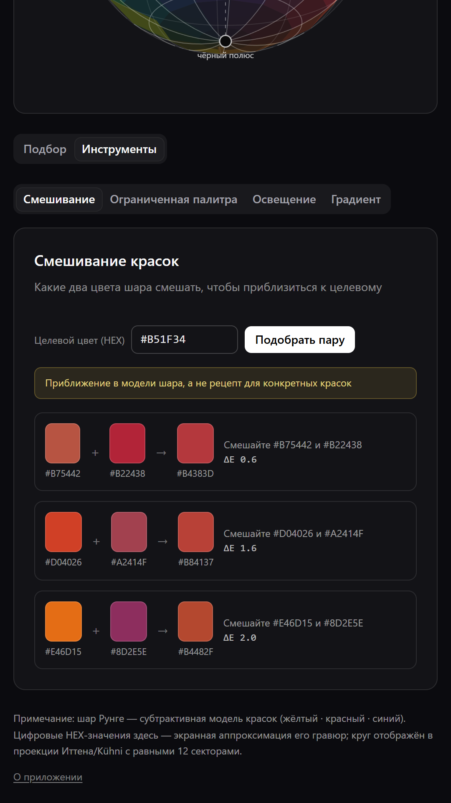
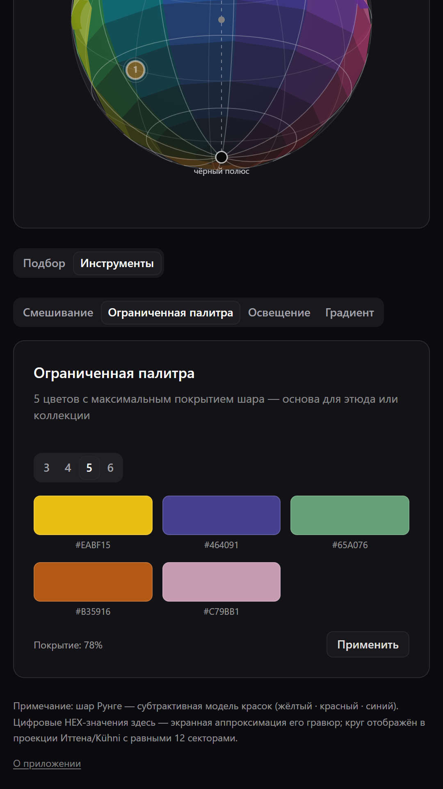
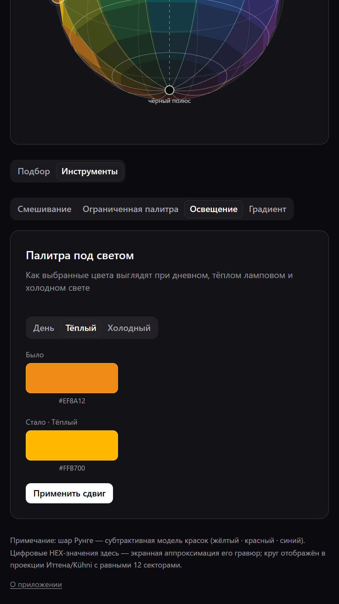
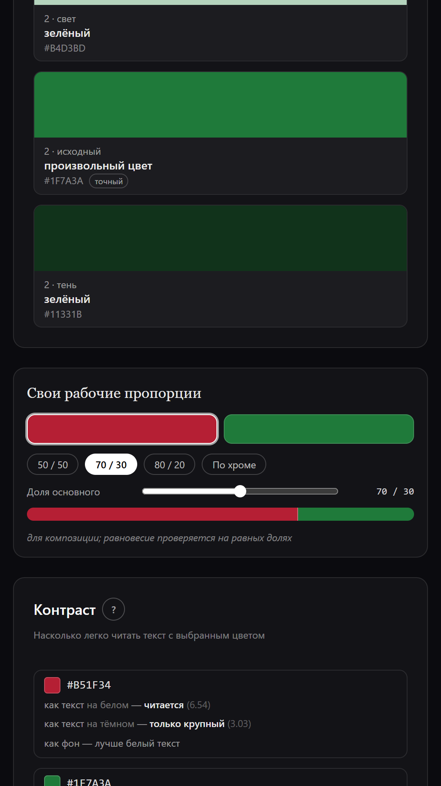
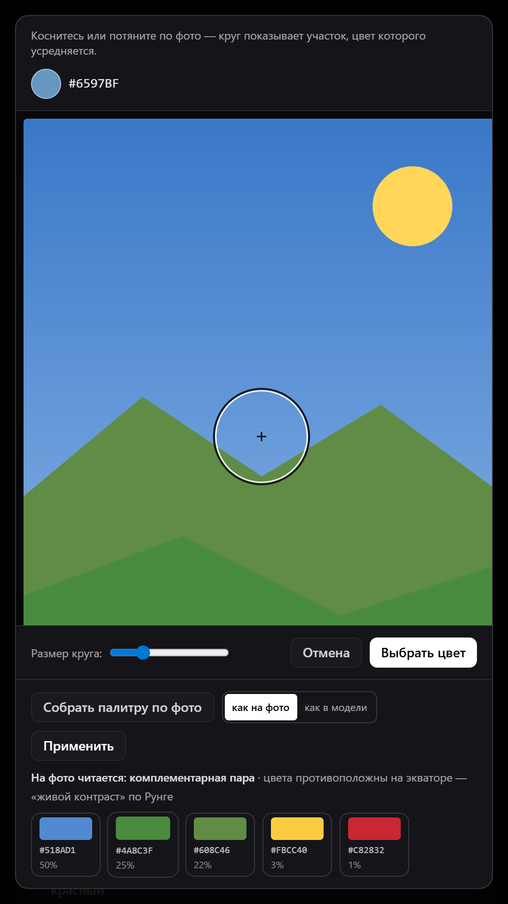

# Цветовой шар Рунге / Runge Color Sphere

**Цветовой круг-шар Филиппа Отто Рунге (1810) в вашем телефоне: гармонии цветов, палитры и подбор цвета с фото.**



## Что умеет

- **12 тонов экватора** на интерактивном трёхмерном шаре с вращением — первая в истории 3D-модель цветового круга;
- **разрезы шара** — экваториальные и полярные сечения, как на гравюрах 1810 года;
- **серые ступени** — шаги насыщенности к серой оси через центр сферы;
- **гармонии по законам шара** — живой контраст (антипод), равносторонний треугольник, меридиан света и тени, аналоговые цвета; для 2–3 цветов — двойной контраст, сплит-комплементарность и баланс треугольника с автокоррекцией;
- **контраст WCAG** — насколько выбранный цвет читается на белом, тёмном и как фон;
- **палитра из фото** — пипетка усредняет цвет выделенного кругом участка снимка из галереи; палитра по фото — до 5 цветов с долями, распознавание цветовой схемы;
- **инструменты** — подбор пары красок для смешивания под заданный цвет (ΔE2000), ограниченная палитра 3–6 цветов с максимальным покрытием шара, предпросмотр палитры под дневным, тёплым и холодным светом;
- **свои рабочие пропорции** — для пары и триады: пресеты (70/30, 60/30/10), ползунки долей с суммой 100, подбор «по хроме», подсказка «равные доли — проверка по Рунге»; доли уходят в экспорт JSON, CSS и на картинку палитры;
- **градиент по шару** — по тону, светлоте или насыщенности, экспорт CSS/SVG/PNG;
- **экспорт ASE / GPL / SVG / CSS / JSON** и отправка палитры картинкой;
- **6 языков**: русский, английский, немецкий, французский, испанский, китайский.







## Установка

1. Откройте [Releases](../../releases) и скачайте `RungeSphere-2.2.1.apk` из последнего выпуска.
2. Разрешите установку из неизвестных источников, когда система спросит.
3. Откройте приложение — оно работает без интернета.

**Требования:** Android 7.0+ (minSdk 24).

## Текущая версия

**2.2.1** (2 ноября 2026) — APK: `RungeSphere-2.2.1.apk`, 4 031 984 байта (3,85 МБ), versionCode 13.

SHA-256:
```
D0733A294E4080799970011FBBD63BBA380EF047BE923D54430840427906B7B8
```

## Лицензия

Бесплатно для личного и некоммерческого использования: учёба, хобби, домашние
и подарочные работы. Для использования в предпринимательской деятельности (работа
с заказчиками, корпоративное применение, включение в платные продукты) требуется
коммерческая лицензия — пишите на proffstandart@rambler.ru. Перепродажа
и распространение изменённых версий запрещены. Подробности — в [LICENSE](LICENSE);
шаблон согласия для коммерческой лицензии — [docs/commercial-license.md](docs/commercial-license.md).

**Приложение не собирает данные и работает без интернета.**

---

## English

**Philipp Otto Runge's color sphere (1810) on your phone: color harmonies, palettes and color picking from photos.**


### Features

- **interactive 3D color wheel** (sphere) with rotation — the first 3D color circle in history; click anywhere to pick a color;
- **sphere cross-sections** — equatorial and polar, as in the 1810 engravings;
- **grey steps** — saturation steps towards the grey axis through the centre of the sphere;
- **harmonies by the laws of the sphere** — living contrast (antipode), equilateral triad, meridian of light and shadow, analogous colors; for 2–3 colors: double contrast, split complementarity and triangle balance analysis with automatic correction;
- **WCAG contrast card** — how the picked color reads on white, on dark, and as a background;
- **palette from a photo** — the picker averages the color of the ring-marked area; the photo palette extracts up to 5 dominant colors with shares and scheme detection;
- **custom working proportions** — for pairs and triads: presets (70/30, 60/30/10), share sliders summing to 100, a "by chroma" suggestion and an "equal shares — Runge check" hint; shares are included in JSON, CSS export and the palette image;
- **artist tools** — paint-pair mixing to a target colour (ΔE2000) with an accuracy score, limited palette of 3–6 colours with maximum sphere coverage, palette preview under daylight, warm and cool light;
- **sphere gradients** — by hue, lightness or saturation, exported to CSS/SVG/PNG;
- **export ASE / GPL / SVG / CSS / JSON** and share palettes as images;
- **6 languages**: Russian, English, German, French, Spanish, Chinese.


### Install

1. Download `RungeSphere-2.2.1.apk` from [Releases](../../releases).
2. Allow installation from unknown sources when the system asks.
3. Open the app — it works offline.

**Requirements:** Android 7.0+ (minSdk 24).

### Current version

**2.2.1** (2 Nov 2026) — APK: `RungeSphere-2.2.1.apk`, 4,031,984 bytes (3.85 MB), versionCode 13.

SHA-256:
```
D0733A294E4080799970011FBBD63BBA380EF047BE923D54430840427906B7B8
```

### License

Free for personal and non-commercial use: study, hobbies, home and gift
projects. Use in business activities (client work, corporate use, inclusion
in paid products) requires a commercial license — write to
proffstandart@rambler.ru. Resale and redistribution of modified versions
are prohibited. See [LICENSE](LICENSE);
the commercial license agreement template — [docs/commercial-license.md](docs/commercial-license.md).

**The app collects no data and works without the internet.**
